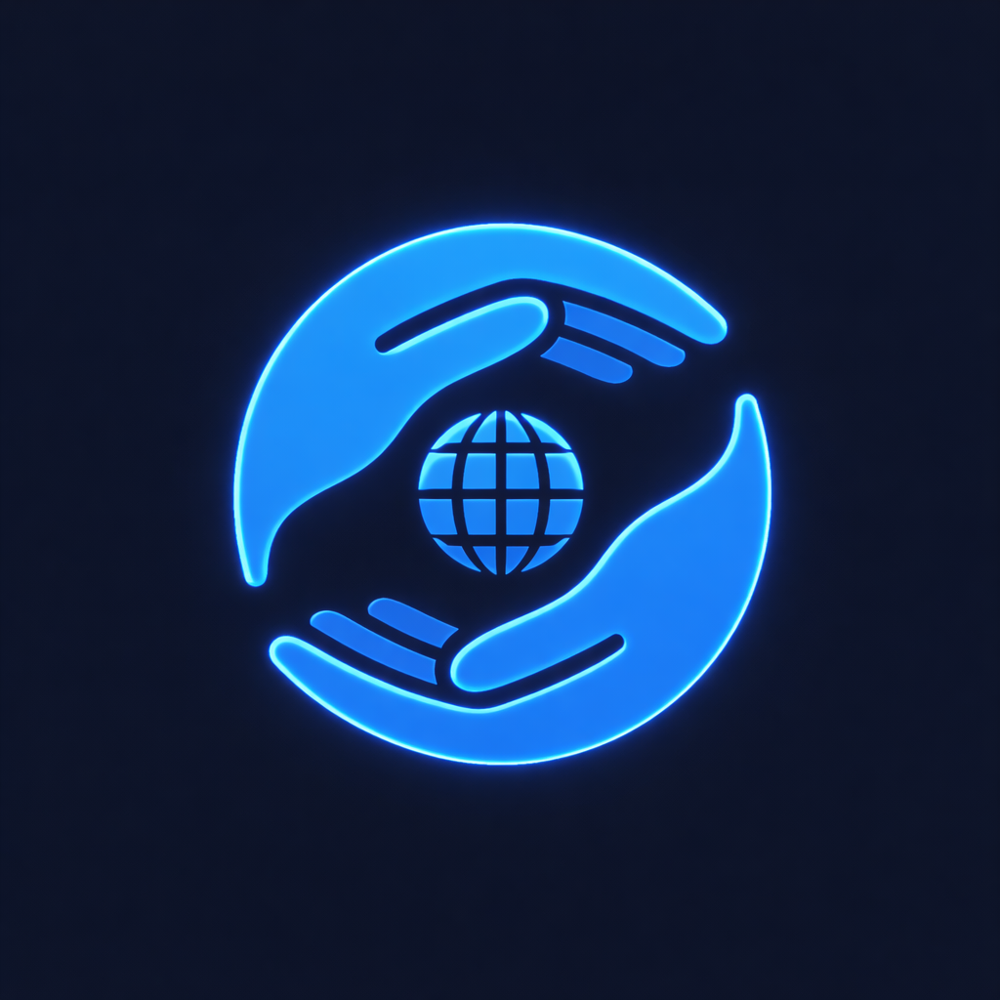
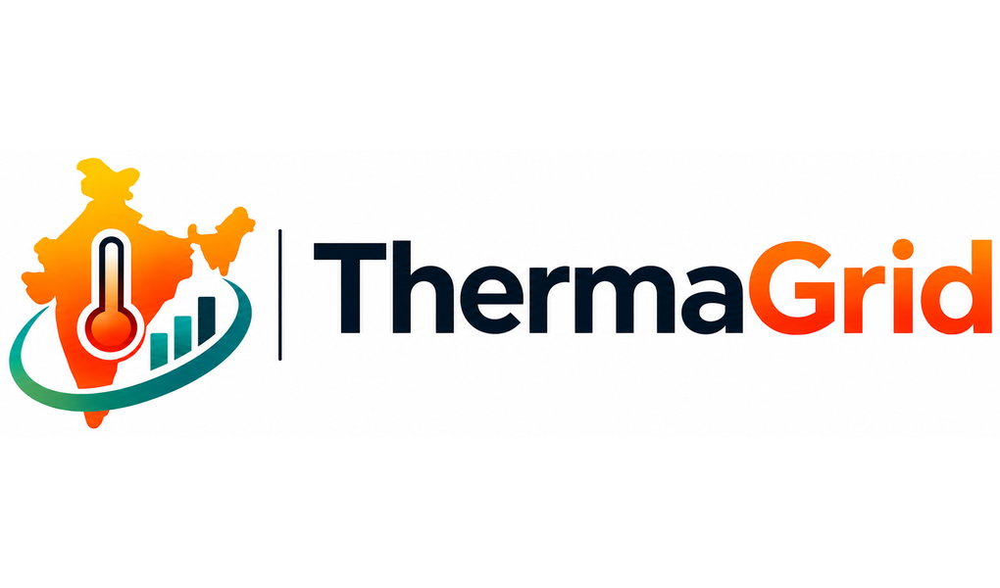
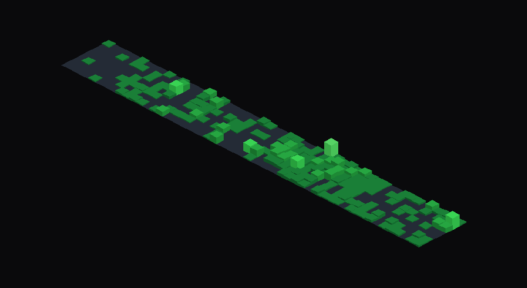

  

<!-- 🎬 PROFILE GIF 🎬 -->

  

<!-- ═══════════════════════════════════════════════════════════════════════════════════ -->

  
  
  
  
  
  

---

## About Me

<table>
  <tr>
    <td width="330" valign="top">
      
    </td>
    <td valign="top">
      
Hi, I'm <strong>Akshat Kardak</strong> — a <strong>Full Stack Developer</strong> and Computer Science engineering student at <strong>Datta Meghe College of Engineering, Mumbai</strong>.

      
I build products end to end: the interface, the backend behind it, the database, authentication, payments, and the AI features on top. My focus is production-ready software a real business can run — not a demo that stops at the happy path.

    </td>
  </tr>
</table>

<table>
  <tr><td><strong>Focus</strong></td><td>Full-stack engineering · Mern Stack Engineering</td></tr>
  <tr><td><strong>Daily stack</strong></td><td>React.js · FastAPI · Python · Node.js · MongoDB</td></tr>
  <tr><td><strong>Shipped</strong></td><td>ThermaGrid · SerpoAI · NagarWatch · RentRide · PaisaMind · UnitedImpact</td></tr>
  <tr><td><strong>Based in</strong></td><td>Mumbai, India</td></tr>
  <tr><td><strong>Open to</strong></td><td>Internships and full-time developer roles</td></tr>
</table>

**💼 Internships**

- **Mastek Ltd.** — *Web Development Intern, Jun–Jul 2026.* Built enterprise AI features in Next.js and FastAPI: AI document processing, an ESP32 face-recognition attendance system and a QR/barcode inventory tracker. Learned how async processing, API design and PDF generation hold up under real usage.
- **Employment Express Verband LLP** — *Web Development Intern, Aug–Oct 2025.* Shipped a corporate site at a 95+ Lighthouse score with a 7-currency pricing engine and GA4 tracking. Learned that frontend work is performance, analytics and SEO as much as layout.

**🚀 Currently focused on**

- Shipping scalable full-stack applications with clean architecture
- Building AI-powered SaaS and productivity platforms
- Going deeper on backend scalability, system design, and cloud deployment

> **"I believe great software isn't just built with good code—it solves real problems, scales efficiently, and delivers an exceptional user experience."**

---

## Experience

<table>
  <tr>
    <td width="100%" valign="top">
      <h3>🏢 Web Development Intern</h3>
      <strong>Mastek Ltd.</strong> 
      <em>June 2026 – July 2026</em>
        
      
      
      
      
      
        
      <ul>
        <li>Developed enterprise-grade full-stack applications using <strong>Next.js, FastAPI, Python, and TypeScript</strong> for AI-powered business solutions</li>
        <li>Built responsive interfaces and integrated frontend components with secure backend APIs for seamless user experiences</li>
        <li>Designed scalable backend services featuring asynchronous processing, file uploads, automated PDF generation, and optimized API execution</li>
        <li>Contributed to <strong>Doppla SoundShield</strong>, an AI-powered music authenticity platform focused on copyright verification and voice clone detection</li>
        <li>Developed an <strong>ESP32 Face Recognition Attendance System</strong>, integrating IoT devices with AI-powered facial recognition for automated attendance management</li>
        <li>Worked on a <strong>QR & Barcode Inventory Management System</strong> for real-time asset tracking and inventory operations</li>
        <li>Collaborated within agile teams, participated in code reviews, and followed enterprise software development practices</li>
      </ul>
    </td>
  </tr>
  <tr>
    <td width="100%" valign="top">
      <h3>🏢 Web Development Intern</h3>
      <strong>Employment Express Verband LLP</strong> 
      <em>Aug 2025 – Oct 2025 · 3 months</em>
        
      
      
      
      
      
      
        
      <ul>
        <li>Built <strong>AnitechCS</strong> — a full-featured professional corporate website deployed on GitHub Pages with a 95+ Lighthouse score across all categories</li>
        <li>Implemented a <strong>multi-currency pricing system</strong> supporting 7 global currencies with static fallback rates and optional live API integration</li>
        <li>Developed an <strong>automated holiday discount system</strong> (15% off) with date-aware detection for Thanksgiving, Christmas & New Year periods</li>
        <li>Integrated <strong>Leaflet.js interactive maps</strong> with custom office markers, a smart chat widget with context-aware responses, and an expandable FAQ accordion</li>
        <li>Built a <strong>content management admin panel</strong> with keyboard shortcuts, live preview, JSON export/import backup, and testimonials manager</li>
        <li>Configured <strong>Google Analytics 4</strong> with custom event tracking for form submissions, currency changes, and user interactions</li>
        <li>Implemented a <strong>math captcha security system</strong> (no external dependencies), form validation, and full SEO setup with JSON-LD structured data</li>
      </ul>
       
      
      
    </td>
  </tr>
</table>

---

## 🚀 Featured Projects

<table>
  <tr>
    <td width="50%" valign="top" align="center">
      
        
      <strong>RentRide – AI Car Rental</strong>
        
      
Built a complete car rental platform enabling users to browse vehicles, make bookings, manage rentals, and complete secure online payments. Features <strong>AI chat assistant (Groq LLaMA with Gemini fallback)</strong>, JWT authentication with role-based access, admin dashboard, booking management, and an integrated Razorpay payment workflow.

      

        
        
        
        
        
      

      
      
    </td>
    <td width="50%" valign="top" align="center">
      
        
      <strong>SerpoAI – Autonomous SEO Growth OS</strong>
        
      
Engineered an autonomous search growth operating system that transforms passive SEO audits into continuous execution. Features deterministic mathematical ICE prioritization, in-server power-law regression model for CTR and traffic prediction, Generative Engine Optimization (GEO) citation radar, AST-verified code patch synthesis, Serpo Bot 1-click GitHub PR dispatch.

      

        
        
        
        
        
      

      
      
    </td>
  </tr>
  <tr>
    <td width="50%" valign="top" align="center">
      
        
      <strong>UnitedImpact – NGO & Donor Platform</strong>
        
      
Built a donation platform connecting NGOs with donors through transparent campaigns and secure online contributions. Features live campaign tracking, location-based NGO discovery, Razorpay integration, volunteer management, real-time geo-mapping, and an admin dashboard for campaign monitoring.

      

        
        
        
        
        
      

      
      
    </td>
    <td width="50%" valign="top" align="center">
      
        
      <strong>PaisaMind – AI Finance OS</strong>
        
      
Developed an AI-powered financial platform helping freelancers and small businesses manage expenses, invoices, taxes, cash flow, and overall financial planning from a single dashboard. Implements AI-driven financial insights through an AI copilot built on 21 deterministic server-side tool contracts rather than free-form generation, alongside a versioned Indian tax rule engine (Section 44ADA presumptive taxation, 194J/194C TDS reconciliation across 9 statutory match states, and GST thresholds), GST-ready invoice generation, automated email reminders, recurring payment tracking, and intelligent business analytics. Covered by 19 backend test files and 114 test cases.

      

        
        
        
        
      

      
      
    </td>
  </tr>
  <tr>
    <td width="50%" valign="top" align="center">
      
        
      <strong>NagarWatch – Civic Issue & Governance Platform</strong>
        
      
Built an enterprise-grade, real-time civic issue reporting, tracking, and governance platform engineered specifically for Indian municipalities. Features 13+ Indian state languages with voice STT, geospatial duplicate prevention, sovereign India GIS map, CPWD contractor performance benchmarking, before/after photo proof audit lifecycle, and automated legal RTI petitions.

      

        
        
        
        
        
      

      
      
    </td>
    <td width="50%" valign="top" align="center">
      
        
      <strong>ThermaGrid – Hyperlocal Heat Stress Intelligence</strong>
        
      
Built a hyperlocal biometeorological analytics and municipal decision-support system engineered for Indian cities. Features multi-index physiological heat strain calculation (ISO 7243 WBGT, UTCI, NOAA Heat Index), Census-calibrated built-environment vulnerability layering, interactive 3D microclimate architectural models, choropleth ward risk mapping, and metabolic shift planning for outdoor workers.

      

        
        
        
        
        
      

      
      
    </td>
  </tr>
</table>

---

## 🛠️ Tech Stack

### 🎨 Frontend

### ⚙️ Backend & Languages

### 🗄️ Databases & Cloud

### 🧰 Tools & DevOps

---

## 📊 GitHub Stats

  

 

---

## 🤝 Let's Connect

I'm always open to <strong>internship opportunities</strong>, <strong>collaborations</strong>, and <strong>cool project ideas</strong>.

&nbsp;

&nbsp;

&nbsp;

 
Built with passion from Mumbai · Always learning, always shipping

